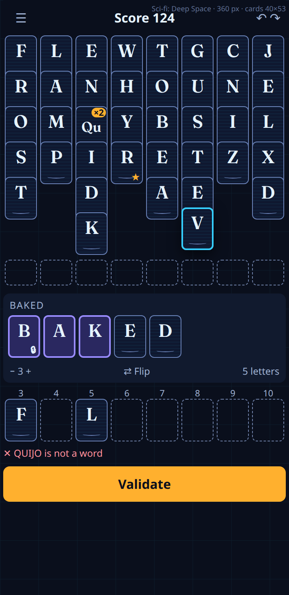
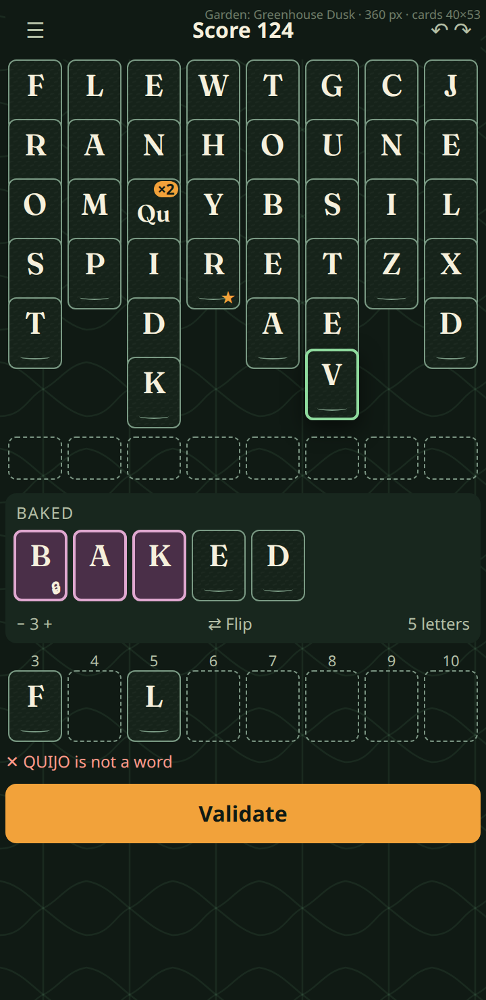
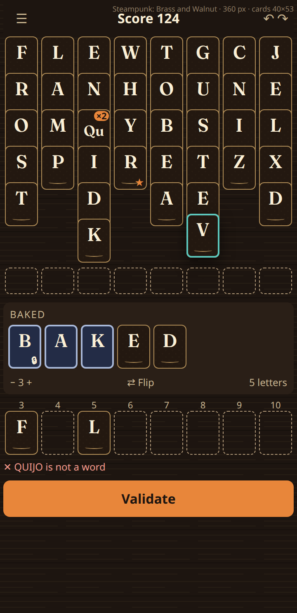
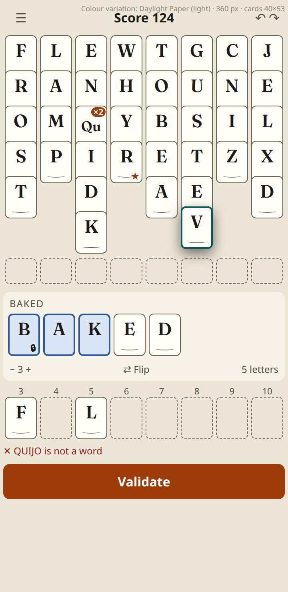
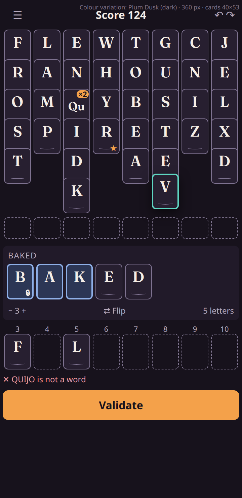
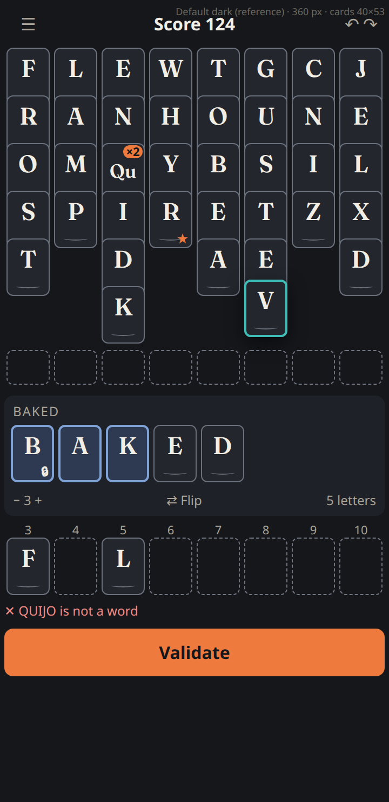

# Theme research and direction brief (ticket 9.1)

Spike for TH-1, TH-5 and TH-9. Nothing here is a decision: the owner picks the themes and the art (see "Question for the owner"). No file outside `epic-themes/research/` was touched.

## What this contains

- Five candidate directions (sci-fi, garden, steampunk, and two simple colour variations: a light one and a dark one), each with a full token set, a 360 px mockup of the same board, computed contrast ratios and an art-size estimate.
- The default dark theme as the reference, rendered the same way: [`mockups/default.html`](mockups/default.html).
- Reproduce everything with `node tools/build.mjs` (writes mockups, `contrast.json`, `art-sizes.json`) and `node tools/shoot.mjs <path to a Playwright install>` (PNGs). Theme data is `tools/themes.mjs`.

## Evidence (competitive and user-voice)

Run through `bmad-deep-recon` at quick preset, two parallel researchers behind the research firewall; digests are in [`recon/digests/`](recon/digests/). The evidence is **thin and mostly from search snippets**, not full pages, so treat it as direction, not proof.

- **Competitive.** Solitaire apps bundle a theme as a table background plus a card back, often seasonal and partly paid (Microsoft Solitaire Collection lists Classic, Beach, Dark Mode and Retro; MobilityWare ships a background and card back per theme). Theme sets in the wild are a mix of colour/dark variants and scenic art. Wordle's high-contrast mode is a plain palette swap (orange/blue), which fits a token-only theme. We found nothing on Words With Friends, Wordscapes or NYT Games theming, and nothing current on art file sizes. Card backs do not apply to WordCell (owner decision), so the transferable parts are the table background and the palette.
- **User voice.** The one repeated player complaint is low contrast between tile, background and text states in dark UIs, and hard-to-read card faces; players ask for adjustability more than for a particular art style. There was no player-voice demand found for steampunk, garden or sci-fi (only vendor copy and commercial precedents such as a garden solitaire and a neon cyberpunk solitaire). One Steam thread (2024-03-17) shows a player bothered by scan-line effects, fixed by an off switch; that is one instance, not prevalence. Colour-only distinctions draw complaints (colour-blind players), which matches DESIGN.md's pairing rule.
- **What it means for us.** Keep letters on cards as calm as the default; put the visual richness on the table and in the palette; any effect that could tire eyes (scan-lines, noise) should be faint or absent; never rely on hue alone. The reach for sci-fi/garden/steampunk is the owner's taste, not demand evidence.
- **Gaps.** No Reddit or Google Play reviews were reachable (search tool is US-only); no Balatro-specific research beyond one shader-complaint thread. A follow-up with a drafted prompt for a user-run tool is possible if the owner wants more evidence before deciding.

## How the numbers were computed

- Ratios are WCAG 2.x contrast ratios from the token hex values. The "DESIGN.md figure" column is the figure DESIGN.md Colors states (or the default's own ratio where DESIGN.md gives none: ink primary on table 4.5, destination outline on table 3.0 are WCAG minimums). A pair passes when it is at least the stated figure (0.05 tolerance for the one-decimal rounding: the default itself measures 13.11, 3.82, 3.61, 7.02, 6.43, 5.59, 9.85, 6.66).
- **Worst-point letter contrast over a texture** assumes the texture's densest layer fully covers the glyph area (card face blended with the texture colour at its maximum opacity), which is an upper bound on how bad any pixel can be. The same worst-point is checked for card edge and outline over the table texture. This is analytic, not sampled from a render; the build ticket should add a sampled check (pixel scan of a rendered face).
- The same board in every mockup: 8 columns at 360 px (card 40 × 53 px, slot 44 px, board 352 px, DESIGN.md Layout), a selected card, a Qu with its ×2 badge, the next-free-letter star, a locked destination block with two free letters in the tray, two placed WordCells, a dashed ghost slot, an invalid-word line and the Validate button. The mockups use the real card font and the real card CSS.
- Art is hand-authored tileable SVG, tiled with `background-image`; it does not affect layout or card size (TH-9).

## A. Sci-fi: Deep Space

Near-black blue table with a faint cyan grid, blue-navy cards with a scan-line texture on the face, cyan as the act accent and amber as the commit accent, violet-blue for the destination block. Reads most clearly as a theme at a glance. Risk: the scan-line texture is the one effect the user-voice evidence shows some players dislike; it is a 6 % line and can be dropped to leave the table grid only.

 — live HTML: [`mockups/scifi.html`](mockups/scifi.html)

**Token set** (all 18 colour tokens of `src/ui/app.css`; `color-scheme` noted in the body):
`--wc-table: #0a0f1c`, `--wc-surface: #111a2e`, `--wc-surface-raised: #1a2641`, `--wc-hairline: #25355a`, `--wc-outline: #6d7fa6`, `--wc-card-face: #0f1830`, `--wc-card-edge: #6a82b8`, `--wc-card-ink: #e6f4ff`, `--wc-ink-primary: #e6f4ff`, `--wc-ink-secondary: #9fb2d4`, `--wc-ink-disabled: #5e6e92`, `--wc-ink-on-accent: #0a0f1c`, `--wc-accent-teal: #35d0ff`, `--wc-accent-orange: #ffb02e`, `--wc-destination: #9a8cff`, `--wc-destination-fill: #2a2860`, `--wc-error: #ff8f9a`, `--wc-scrim: #000000b3`

**Art:** Table: 48 px grid tile (`tools/themes.mjs`, `table_art`), one-tone line at 7 % opacity. Card face: 4 px scan-line tile at 6 % opacity.

**Size:** token block 453 B raw / 259 B gzip; art tiles 287 B raw / 265 B gzip; total about **524 B gzip**.

**Computed contrast** (script `tools/build.mjs`, WCAG 2.x relative luminance; full data `contrast.json`):

| Pair | Ratio | DESIGN.md figure | Result |
|---|---|---|---|
| card ink on card face | 15.71:1 | ≥ 13.1:1 | pass |
| outline on table | 4.77:1 | ≥ 3.8:1 | pass |
| outline on surface | 4.32:1 | ≥ 3.4:1 | pass |
| card edge on table | 5.01:1 | ≥ 3.6:1 | pass |
| card edge on surface | 4.54:1 | ≥ 3.2:1 | pass |
| ink secondary on surface | 8.09:1 | ≥ 6.4:1 | pass |
| ink secondary on surface raised | 7.01:1 | ≥ 5.6:1 | pass |
| accent teal on surface | 9.59:1 | ≥ 7:1 | pass |
| accent teal on card face | 9.73:1 | ≥ 6.6:1 | pass |
| ink on accent orange | 10.47:1 | ≥ 6.4:1 | pass |
| card ink on destination fill | 11.94:1 | ≥ 9.9:1 | pass |
| error on surface | 7.97:1 | ≥ 6.7:1 | pass |
| ink primary on table | 17.08:1 | ≥ 4.5:1 | pass |
| destination outline on table | 6.89:1 | ≥ 3:1 | pass |
| card ink over worst face-texture point | 14.1:1 | ≥ 13.1:1 | pass |
| card edge over worst face-texture point (info) | 4.14:1 | ≥ 3:1 | pass |
| card edge over worst table-texture point | 4.47:1 | ≥ 3.6:1 | pass |
| outline over worst table-texture point | 4.26:1 | ≥ 3.8:1 | pass |

## B. Garden: Greenhouse Dusk

Deep moss-green table with a faint leaf-vein pattern, dark bark-green cards with cream ink, a sage-green act accent, marigold commit accent and a blossom-pink destination block. The warmest and most distinct palette. **Owner decision needed on one rule:** DESIGN.md's Avoid list says no green "success" states; here green is only the act/selection accent and the table, and nothing turns green on success, but it is green the player will see on every selection. If the owner says no, the fallback is to keep the default teal on the green table (the act accent then has less separation from the table; it would need a re-check of the contrast figures).

 — live HTML: [`mockups/garden.html`](mockups/garden.html)

**Token set** (all 18 colour tokens of `src/ui/app.css`; `color-scheme` noted in the body):
`--wc-table: #101a14`, `--wc-surface: #18271e`, `--wc-surface-raised: #223528`, `--wc-hairline: #2f4637`, `--wc-outline: #7a9482`, `--wc-card-face: #16231a`, `--wc-card-edge: #7a9a84`, `--wc-card-ink: #f6f0dc`, `--wc-ink-primary: #f6f0dc`, `--wc-ink-secondary: #b4bfa6`, `--wc-ink-disabled: #6e7c68`, `--wc-ink-on-accent: #101a14`, `--wc-accent-teal: #8fdc9e`, `--wc-accent-orange: #f2a23a`, `--wc-destination: #e0a8d0`, `--wc-destination-fill: #4a2f48`, `--wc-error: #ff9a8a`, `--wc-scrim: #000000b3`

**Art:** Table: 64 px leaf-vein tile, two curves and a stem at 8 % opacity. Card face: 6 px paper-fibre tile at 3 % opacity (5 % failed the card-ink figure at 11.4:1, so it was cut).

**Size:** token block 454 B raw / 255 B gzip; art tiles 409 B raw / 332 B gzip; total about **587 B gzip**.

**Computed contrast** (script `tools/build.mjs`, WCAG 2.x relative luminance; full data `contrast.json`):

| Pair | Ratio | DESIGN.md figure | Result |
|---|---|---|---|
| card ink on card face | 14.28:1 | ≥ 13.1:1 | pass |
| outline on table | 5.41:1 | ≥ 3.8:1 | pass |
| outline on surface | 4.74:1 | ≥ 3.4:1 | pass |
| card edge on table | 5.75:1 | ≥ 3.6:1 | pass |
| card edge on surface | 5.03:1 | ≥ 3.2:1 | pass |
| ink secondary on surface | 8.12:1 | ≥ 6.4:1 | pass |
| ink secondary on surface raised | 6.81:1 | ≥ 5.6:1 | pass |
| accent teal on surface | 9.57:1 | ≥ 7:1 | pass |
| accent teal on card face | 10:1 | ≥ 6.6:1 | pass |
| ink on accent orange | 8.48:1 | ≥ 6.4:1 | pass |
| card ink on destination fill | 10.28:1 | ≥ 9.9:1 | pass |
| error on surface | 7.6:1 | ≥ 6.7:1 | pass |
| ink primary on table | 15.61:1 | ≥ 4.5:1 | pass |
| destination outline on table | 9.05:1 | ≥ 3:1 | pass |
| card ink over worst face-texture point | 13.25:1 | ≥ 13.1:1 | pass |
| card edge over worst face-texture point (info) | 4.88:1 | ≥ 3:1 | pass |
| card edge over worst table-texture point | 4.86:1 | ≥ 3.6:1 | pass |
| outline over worst table-texture point | 4.58:1 | ≥ 3.8:1 | pass |

## C. Steampunk: Brass and Walnut

Walnut-brown table with wood-grain planks, dark leather cards with a brass edge and parchment ink, verdigris teal and copper orange kept as the two accents (they read as brass patina and copper, so the meanings are unchanged), grey-blue destination. The brass card edge is what makes it read as steampunk without any illustration.

 — live HTML: [`mockups/steampunk.html`](mockups/steampunk.html)

**Token set** (all 18 colour tokens of `src/ui/app.css`; `color-scheme` noted in the body):
`--wc-table: #1d1510`, `--wc-surface: #2a1f17`, `--wc-surface-raised: #3a2b20`, `--wc-hairline: #4a382a`, `--wc-outline: #b09878`, `--wc-card-face: #231810`, `--wc-card-edge: #b08d57`, `--wc-card-ink: #fbf0d6`, `--wc-ink-primary: #fbf0d6`, `--wc-ink-secondary: #c8b48f`, `--wc-ink-disabled: #8a7860`, `--wc-ink-on-accent: #1d1510`, `--wc-accent-teal: #5cc8bd`, `--wc-accent-orange: #e8863a`, `--wc-destination: #a8b8d8`, `--wc-destination-fill: #232c46`, `--wc-error: #f59a8c`, `--wc-scrim: #000000b3`

**Art:** Table: 80 × 40 px plank tile, grain lines at 7 % and a dark seam. Card face: 8 px leather-pebble tile at 4 % opacity (6 % failed). The table texture pulls the card-edge reach to 3.9:1 (still above the 3.6 figure).

**Size:** token block 457 B raw / 260 B gzip; art tiles 434 B raw / 317 B gzip; total about **577 B gzip**.

**Computed contrast** (script `tools/build.mjs`, WCAG 2.x relative luminance; full data `contrast.json`):

| Pair | Ratio | DESIGN.md figure | Result |
|---|---|---|---|
| card ink on card face | 15.32:1 | ≥ 13.1:1 | pass |
| outline on table | 6.52:1 | ≥ 3.8:1 | pass |
| outline on surface | 5.82:1 | ≥ 3.4:1 | pass |
| card edge on table | 5.82:1 | ≥ 3.6:1 | pass |
| card edge on surface | 5.2:1 | ≥ 3.2:1 | pass |
| ink secondary on surface | 7.94:1 | ≥ 6.4:1 | pass |
| ink secondary on surface raised | 6.71:1 | ≥ 5.6:1 | pass |
| accent teal on surface | 8:1 | ≥ 7:1 | pass |
| accent teal on card face | 8.64:1 | ≥ 6.6:1 | pass |
| ink on accent orange | 6.77:1 | ≥ 6.4:1 | pass |
| card ink on destination fill | 12.19:1 | ≥ 9.9:1 | pass |
| error on surface | 7.56:1 | ≥ 6.7:1 | pass |
| ink primary on table | 15.88:1 | ≥ 4.5:1 | pass |
| destination outline on table | 9.01:1 | ≥ 3:1 | pass |
| card ink over worst face-texture point | 14.49:1 | ≥ 13.1:1 | pass |
| card edge over worst face-texture point (info) | 5.31:1 | ≥ 3:1 | pass |
| card edge over worst table-texture point | 3.93:1 | ≥ 3.6:1 | pass |
| outline over worst table-texture point | 4.4:1 | ≥ 3.8:1 | pass |

## D. Daylight Paper (light colour variation)

The only light option: warm paper table, white cards with near-black ink, darker teal and orange so both accents hold 7.0:1 and 6.4:1. No art. Flips `color-scheme` to light and the `theme-color` meta to the paper colour; the scrim stays dark. It is the biggest departure from the brand line ("ivory on charcoal") and from DESIGN.md's single dark look, so it is the most valuable colour variation for daylight use and the most contentious one for the brand.

 — live HTML: [`mockups/paper.html`](mockups/paper.html)

**Token set** (all 18 colour tokens of `src/ui/app.css`; `color-scheme` noted in the body):
`--wc-table: #ece6d8`, `--wc-surface: #f6f2e8`, `--wc-surface-raised: #ffffff`, `--wc-hairline: #d6cebb`, `--wc-outline: #6d6757`, `--wc-card-face: #fffdf7`, `--wc-card-edge: #6a6455`, `--wc-card-ink: #1d1b17`, `--wc-ink-primary: #1d1b17`, `--wc-ink-secondary: #55503f`, `--wc-ink-disabled: #8c8671`, `--wc-ink-on-accent: #ffffff`, `--wc-accent-teal: #065a55`, `--wc-accent-orange: #9c3a08`, `--wc-destination: #2f5a99`, `--wc-destination-fill: #dbe6f7`, `--wc-error: #8f1f17`, `--wc-scrim: #000000b3`

**Art:** None (tokens only).

**Size:** token block 453 B raw / 254 B gzip; art tiles 0 B raw / 0 B gzip; total about **254 B gzip**.

**Computed contrast** (script `tools/build.mjs`, WCAG 2.x relative luminance; full data `contrast.json`):

| Pair | Ratio | DESIGN.md figure | Result |
|---|---|---|---|
| card ink on card face | 16.9:1 | ≥ 13.1:1 | pass |
| outline on table | 4.53:1 | ≥ 3.8:1 | pass |
| outline on surface | 5.04:1 | ≥ 3.4:1 | pass |
| card edge on table | 4.73:1 | ≥ 3.6:1 | pass |
| card edge on surface | 5.27:1 | ≥ 3.2:1 | pass |
| ink secondary on surface | 7.21:1 | ≥ 6.4:1 | pass |
| ink secondary on surface raised | 8.06:1 | ≥ 5.6:1 | pass |
| accent teal on surface | 7.22:1 | ≥ 7:1 | pass |
| accent teal on card face | 7.94:1 | ≥ 6.6:1 | pass |
| ink on accent orange | 6.95:1 | ≥ 6.4:1 | pass |
| card ink on destination fill | 13.65:1 | ≥ 9.9:1 | pass |
| error on surface | 7.91:1 | ≥ 6.7:1 | pass |
| ink primary on table | 13.82:1 | ≥ 4.5:1 | pass |
| destination outline on table | 5.55:1 | ≥ 3:1 | pass |

## E. Plum Dusk (dark colour variation)

Same dark layout, plum-charcoal surfaces, teal and orange accents nudged warmer. The cheapest, safest option: tokens only, no art, no brand rule relaxed.

 — live HTML: [`mockups/dusk.html`](mockups/dusk.html)

**Token set** (all 18 colour tokens of `src/ui/app.css`; `color-scheme` noted in the body):
`--wc-table: #17121c`, `--wc-surface: #211a29`, `--wc-surface-raised: #2d2438`, `--wc-hairline: #3d3249`, `--wc-outline: #807590`, `--wc-card-face: #271f30`, `--wc-card-edge: #7e7290`, `--wc-card-ink: #f6eee6`, `--wc-ink-primary: #f6eee6`, `--wc-ink-secondary: #b5a9bd`, `--wc-ink-disabled: #7b6f85`, `--wc-ink-on-accent: #17121c`, `--wc-accent-teal: #5ed6c2`, `--wc-accent-orange: #f4a14a`, `--wc-destination: #8fb0e8`, `--wc-destination-fill: #2c3655`, `--wc-error: #f59aa0`, `--wc-scrim: #000000b3`

**Art:** None (tokens only).

**Size:** token block 452 B raw / 258 B gzip; art tiles 0 B raw / 0 B gzip; total about **258 B gzip**.

**Computed contrast** (script `tools/build.mjs`, WCAG 2.x relative luminance; full data `contrast.json`):

| Pair | Ratio | DESIGN.md figure | Result |
|---|---|---|---|
| card ink on card face | 13.81:1 | ≥ 13.1:1 | pass |
| outline on table | 4.27:1 | ≥ 3.8:1 | pass |
| outline on surface | 3.91:1 | ≥ 3.4:1 | pass |
| card edge on table | 4.12:1 | ≥ 3.6:1 | pass |
| card edge on surface | 3.77:1 | ≥ 3.2:1 | pass |
| ink secondary on surface | 7.53:1 | ≥ 6.4:1 | pass |
| ink secondary on surface raised | 6.6:1 | ≥ 5.6:1 | pass |
| accent teal on surface | 9.54:1 | ≥ 7:1 | pass |
| accent teal on card face | 8.96:1 | ≥ 6.6:1 | pass |
| ink on accent orange | 8.81:1 | ≥ 6.4:1 | pass |
| card ink on destination fill | 10.36:1 | ≥ 9.9:1 | pass |
| error on surface | 8.05:1 | ≥ 6.7:1 | pass |
| ink primary on table | 16.05:1 | ≥ 4.5:1 | pass |
| destination outline on table | 8.37:1 | ≥ 3:1 | pass |

## Reference: default dark (not a candidate)

 — [`mockups/default.html`](mockups/default.html). Size: token block 257 B gzip. The mockup uses the same code path as the five directions, so the other mockups are visually comparable at 360 px; it also proves the generator reproduces DESIGN.md's figures (13.11, 3.82, 3.61, 7.02, 6.43).

## Size against the 600,000-byte budget (TH-8)

The budget is the gzip-9 sum of the build's counted set (`scripts/size-budget.mjs`, AD-18). The most recent `dist/` in the main checkout measures **549,827 of 600,000 bytes**: the dictionary is 454,262 B, the JS 83,773 B, the CSS 7,092 B, the font 4,307 B (that `dist/` may predate the latest commits; 9.3 should re-measure). The headroom is **about 50,000 bytes for every theme together**.

| Direction | Gzip estimate | Share of headroom |
|---|---|---|
| A. Sci-fi (tokens + 2 SVG tiles) | ~524 B | ~1 % |
| B. Garden (tokens + 2 SVG tiles) | ~587 B | ~1.2 % |
| C. Steampunk (tokens + 2 SVG tiles) | ~577 B | ~1.2 % |
| D. Daylight Paper (tokens) | ~254 B | ~0.5 % |
| E. Plum Dusk (tokens) | ~258 B | ~0.5 % |

Reading: colour sets and hand-authored SVG tiles are trivially cheap (all five together about 2.7 KB). The budget is only at risk from **raster art**: a single 20–40 KB WebP texture per theme would eat 40–80 % of the headroom across three themes, and raster does not gzip further. So: SVG patterns and CSS only, no photographic textures, no illustrations, unless the owner chooses richer art and accepts a budget decision (a separate owner call about AD-18). Also note the existing rule that the dictionary must download once (AD-8) is unaffected, and the service worker precache limit (4,000,000 B per file) is not a constraint.

## Trade-offs

| | Theme read at a glance | Art cost | Contrast risk | Brand rule touched |
|---|---|---|---|---|
| A. Sci-fi | Strong | Low (2 tiles) | Low (scan-line at 6 %) | None; violet destination |
| B. Garden | Strong | Low (2 tiles) | Low (3 % fibre) | Green act accent (Avoid list wording) |
| C. Steampunk | Strong via brass edge | Low (2 tiles) | Medium (wood grain under card edges, 3.9:1 reach) | None |
| D. Daylight Paper | Strong, but a different product mood | None | Medium (accents darkened) | Inverts "ivory on charcoal"; single dark look |
| E. Plum Dusk | Mild | None | Low | None |

Other points the owner may want:
- A table texture is the safe place for richness; a card-face texture is the risky one (TH-9 requires worst-point contrast). Texture-free faces for any theme is a free simplification that removes the one risk.
- Sci-fi, garden and steampunk each need a small amount of screenshot baseline work (TH-6); two themes with art cost about the same as three without.
- `Scene.svelte` has two fixed literals (`#fff`, `#1a1a1a`) and four drag-layer shadows use `#0008`; these are the colours ticket 9.3 settles (shadows are a token candidate).
- Palette notes for any direction: destination and error colours were changed per theme only to keep their contrast and their glyph pairing; no state in any mockup relies on hue alone (lock glyph, ✕, star, ring).

## Question for the owner (decision gate for ticket 9.1)

Which directions should be built, and which art goes with each? Concretely, please answer:

1. Which of A–E to build (any number, including none).
2. For each chosen direction: table background only, table background plus card-face texture, or colours only. (My lean, not a decision: table background only; it keeps the card faces calm and the contrast risk at zero.)
3. For Garden specifically: allow the green sage act accent (relaxing the Avoid list's "no green" wording for that theme), or keep teal?
4. For Daylight Paper: acceptable to ship a light theme despite A-D1's dark brand line?
5. Is faint scan-line texture on sci-fi card faces acceptable, or table grid only?

Record the answer as a dated `Decision:` in the epic Notes (not done in this session).
